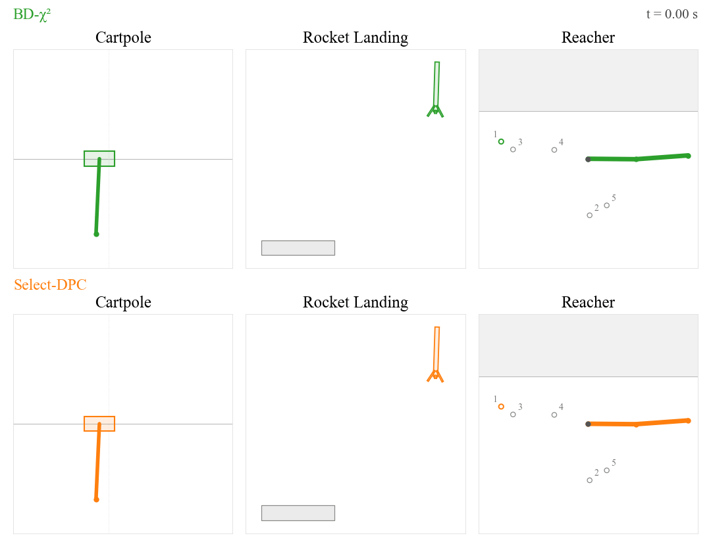
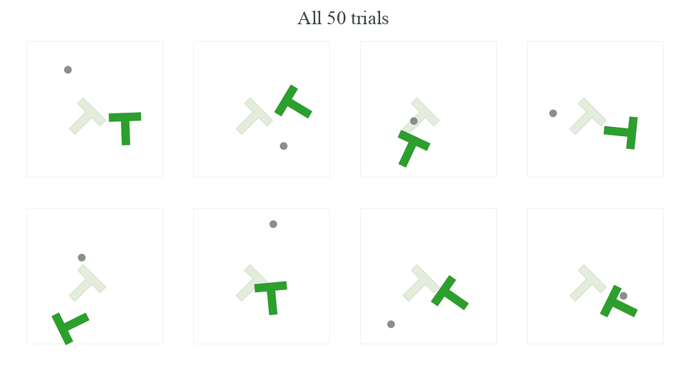

# Behavioral Denoising

Code for **[Behavioral Denoising: A New Perspective
on Nonlinear Behavioral Control Inspired by Closed-Form Diffusion Policies](https://arxiv.org/abs/2611.19712)**.

This branch contains the current implementation and runnable examples for
Cartpole, Rocket Landing, Reacher, and Push-T.
For the **L4DC submission code, saved results, and paper reproduction instructions**,
see the [`l4dc` branch](https://github.com/RoboticExplorationLab/behavioral-denoising/tree/l4dc).

[Paper](https://arxiv.org/abs/2611.19712) ·
[Configurations](config/README.md) · [Implementation](IMPLEMENTATION.md) ·
[Demonstrations](data/README.md) ·
[Video gallery](https://roboticexplorationlab.github.io/behavioral-denoising/)

## BD-χ² across four tasks


Selected rollouts from the L4DC submission, at real-time playback. Each panel
holds its final pose after the run ends. The updated Push-T controller is shown
in the gallery below.

## Comparison with [Select-DPC](https://github.com/naefjo/choose-wisely-paper)



BD-χ² (top, green) and Select-DPC (bottom, orange), starting from the same states.
These selected submission trials show BD-χ² succeeding where Select-DPC fails.
Playback is synchronized by simulation time, with final poses held after termination.

## Push-T update

BD-χ² and Select-DPC now express the pusher position and planned action targets in
the block's coordinate frame, while retaining the block's absolute pose. All
rows below use the same 50 starts, demonstrations, and execution schedule.
World-coordinate rows are the previous results. Controller parameters were
not retuned for the relative representation.

| Method | Coordinates | Mean peak coverage | Mean final coverage |
|---|---|---:|---:|
| BD-χ² | World | 63.09% | 57.99% |
| BD-χ² | Block-relative | 94.43% | 88.16% |
| Select-DPC | World | 6.28% | 2.23% |
| Select-DPC | Block-relative | 10.55% | 0.00% |

Relative Select-DPC produced frequent OSQP inaccurate-solution warnings.
These values include all trials and the controller's existing fallback behavior.

[](https://roboticexplorationlab.github.io/behavioral-denoising/)

[Watch all 50 updated trials](https://roboticexplorationlab.github.io/behavioral-denoising/),
with peak and final coverage for each trial. Coverage is the fraction of the goal
shape covered by the block. Trials stop above 95% coverage or after 30 seconds.
The [L4DC submission gallery](https://roboticexplorationlab.github.io/behavioral-denoising/l4dc/)
retains all 50 original rollouts.

## Install

Tested with Python 3.10 on Ubuntu 22.04. From the repository root, create separate
environments for the control benchmarks and Push-T, which require different NumPy versions:

```bash
python3.10 -m venv .venv
.venv/bin/python -m pip install -r requirements/benchmark.txt
python3.10 -m venv .venv-pusht
.venv-pusht/bin/python -m pip install -r requirements/pusht.txt
```

The simulators and demonstrations are included. No GPU is needed.

## Run the examples

Use one numerical thread per worker. If a robotics shell such as ROS sets
`PYTHONPATH`, unset it first: imports use `src.*`, so `src/` itself must not be on
`PYTHONPATH`.

```bash
unset PYTHONPATH
export OPENBLAS_NUM_THREADS=1 OMP_NUM_THREADS=1 MKL_NUM_THREADS=1
export SDL_VIDEODRIVER=dummy MPLBACKEND=Agg
```

Start with one method and one initial state:

```bash
.venv/bin/python -m experiments.cartpole --methods bd_chi2 --seeds 10003 --output runs/check
.venv-pusht/bin/python -m experiments.pusht --methods bd_chi2 --seeds 300031 --output runs/check
```

To run the configured methods and starts for each task:

```bash
.venv/bin/python -m experiments.cartpole --output runs/benchmark
.venv/bin/python -m experiments.rocket --output runs/benchmark
.venv/bin/python -m experiments.reacher --output runs/benchmark
.venv-pusht/bin/python -m experiments.pusht --output runs/benchmark
```

Records are saved under `<output>/<task>/<method>/seed_<seed>/`, including states,
actions, references, outcomes, and timing. Repeat a command to resume it. Use a new
output directory after changing settings. Generated runs are not committed.

`--methods` accepts `bd_mean`, `bd_sample`, `bd_kl`, `bd_mean_chi2`, `bd_chi2`,
`select_dpc`, `windowed_deepc`, and `deepc`. Push-T supports `bd_chi2` and `select_dpc`.
Use `--steps` for a shorter trial. DeePC can take many hours to run.

Both Push-T methods default to `block_relative` observations and action targets.
To select this representation explicitly, run:

```bash
.venv-pusht/bin/python -m experiments.pusht --representation block_relative \
  --methods bd_chi2 select_dpc --output runs/pusht_relative
```

Use `--representation world` for both methods to use absolute coordinates.
The gallery above shows BD-χ². See the
[coordinate configuration](config/README.md#push-t-coordinates) for per-method
overrides. Saved trajectories and executed actions remain in world coordinates.

## View your runs

Reports and visualizations read saved trajectories without rerunning controllers:

```bash
.venv/bin/python scripts/report.py --root runs/benchmark
.venv/bin/python scripts/plot.py --root runs/benchmark --group control
.venv-pusht/bin/python scripts/plot.py --root runs/benchmark --group pusht
```

Add `--videos` and install FFmpeg to generate motion videos. See the
[gallery instructions](website/README.md) to build a Push-T page from your own runs
or preview the published gallery assets. Paper figures and their reconstruction
scripts are available on [`l4dc`](https://github.com/RoboticExplorationLab/behavioral-denoising/tree/l4dc).

## Timing and tests

Timing replays saved controller queries and excludes initialization and simulation:

```bash
.venv/bin/python scripts/timing.py --root runs/benchmark --task cartpole --method bd_chi2
```

The timing record includes process CPU time, CPU affinity, SMT topology, and
background load. Use a quiet machine for comparisons.

Run tests in their corresponding environments. No saved benchmark results are required:

```bash
.venv/bin/python -m pytest -q -rs --ignore=tests/test_pusht.py --ignore=tests/test_pusht_task.py --ignore=tests/test_select_dpc_chunks.py
.venv-pusht/bin/python -m pytest -q -rs tests/test_pusht.py tests/test_pusht_task.py tests/test_pusht_coordinates.py tests/test_pusht_representations.py tests/test_select_dpc_chunks.py tests/test_gallery.py
```

## Citation

If you use this code, please cite our paper:

```bibtex
@misc{jia2026behavioraldenoising,
  title = {Behavioral Denoising: A New Perspective on Nonlinear Behavioral Control Inspired by Closed-Form Diffusion Policies},
  author = {Jia, Lucas Y. and Zhang, John Z. and Manchester, Zachary},
  year = {2026},
  eprint = {2611.19712},
  archivePrefix = {arXiv},
  primaryClass = {eess.SY},
  doi = {10.48550/arXiv.2611.19712},
  url = {https://arxiv.org/abs/2611.19712}
}
```

## Acknowledgments

We thank the authors of the following awesome projects:

- [Select-DPC](https://github.com/naefjo/choose-wisely-paper), from
  which we adapted the control benchmarks and the Select-DPC, DeePC, and Windowed
  DeePC baseline implementations.
- [Diffusion Policy](https://github.com/real-stanford/diffusion_policy), for the
  Push-T environment and released human demonstrations.
- [COCO Rocket Lander](https://gitlab.ethz.ch/bsaverio/coco-project), for the Rocket
  simulator and dynamics model.

Simulation uses [MuJoCo](https://mujoco.org/),
[Gymnasium](https://gymnasium.farama.org/), [Box2D](https://box2d.org/), and
[Pymunk](https://www.pymunk.org/). The MPC experts and optimization baselines use
[CasADi](https://web.casadi.org/), [IPOPT](https://coin-or.github.io/Ipopt/),
[CVXPY](https://www.cvxpy.org/), and [OSQP](https://osqp.org/).

We used Codex for assistance with code development, review,
testing, and documentation.

The project is released under the [MIT license](LICENSE). See
[CITATION.cff](CITATION.cff) and [third-party notices](third_party/README.md).
