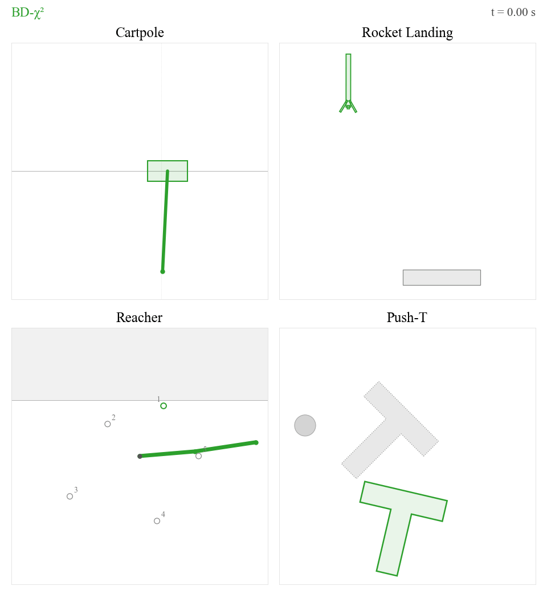

# Behavioral Denoising

Code for **Behavioral Denoising: A New Perspective
on Nonlinear Behavioral Control Inspired by Closed-Form Diffusion Policies**.

[Paper results](results/README.md) · [Configurations](config/README.md) ·
[Implementation](IMPLEMENTATION.md) · [Data](data/README.md) ·
[Video gallery](https://roboticexplorationlab.github.io/behavioral-denoising/)

## BD-χ² across four tasks



Selected successful rollouts at real-time playback. Each panel holds its final
pose after the run ends.

## Comparison with [Select-DPC](https://github.com/naefjo/choose-wisely-paper)


BD-χ² (top, green) and Select-DPC (bottom, orange), starting from the same states.
These selected trials show BD-χ² succeeding where Select-DPC fails. Playback is
synchronized by simulation time, with final poses held after termination.

## All Push-T trials

[](https://roboticexplorationlab.github.io/behavioral-denoising/)

[Watch all 50 BD-χ² trials](https://roboticexplorationlab.github.io/behavioral-denoising/):
peak and final coverage for each trial, with coverage summaries and seed search.

## Install

Tested with Python 3.10 on Ubuntu 22.04. Run the following commands from the repository root to set up venvs used for this codebase.
The control benchmark and Push-T use different NumPy versions so they require separate environments:

```bash
python3.10 -m venv .venv
.venv/bin/python -m pip install -r requirements/benchmark.txt
python3.10 -m venv .venv-pusht
.venv-pusht/bin/python -m pip install -r requirements/pusht.txt
```

The simulators are included under `third_party/`. No GPU is needed.

## Reproduce the tables and figures

Demonstrations are included. To use the saved paper results without rerunning
the experiments, first extract the bundled archive from the repository root:

```bash
.venv/bin/python -m zipfile -e results/paper.zip .
```

Then rebuild the tables and figures:

```bash
.venv/bin/python scripts/prepare_data.py --verify
.venv/bin/python scripts/report.py --require-complete
.venv/bin/python scripts/plot.py --group control
.venv-pusht/bin/python scripts/plot.py --group pusht
```

Figures are written to `results/paper/figures/`. The extracted
`results/paper/README.md` reports success criteria, costs, and computation times.
To plot and report your own experiment runs, add `--root results/reproduction`
to the report and plot commands above.

With FFmpeg installed, regenerate the README animations with
`.venv-pusht/bin/python scripts/plots/readme_teasers.py`. See the
[gallery instructions](website/README.md) to build and preview the full Push-T page.

## Run the experiments

Use one numerical thread per worker. If a robotics shell (e.g., ROS) sets `PYTHONPATH`, unset
it before running: this project imports `src.*` and must not add `src/` itself to
`PYTHONPATH` (it contains a module named `selectors`).

```bash
unset PYTHONPATH
export OPENBLAS_NUM_THREADS=1 OMP_NUM_THREADS=1 MKL_NUM_THREADS=1
export SDL_VIDEODRIVER=dummy MPLBACKEND=Agg
.venv/bin/python -m experiments.cartpole --output results/reproduction
.venv/bin/python -m experiments.rocket --output results/reproduction
.venv/bin/python -m experiments.reacher --output results/reproduction
.venv-pusht/bin/python -m experiments.pusht --output results/reproduction
```

Each task uses its fixed paper configurations and saved test starts. Results are
stored under `<output>/<task>/<method>/seed_<seed>/`. Repeat the same command
to resume an interrupted run. Use a new output directory when changing settings.
`results/paper/` is reserved for the provided results.

For a quick check, select one method and start:

```bash
.venv/bin/python -m experiments.cartpole --methods bd_chi2 --seeds 10003 --output results/check
```

`--methods` accepts `bd_mean`, `bd_sample`, `bd_kl`, `bd_mean_chi2`, `bd_chi2`,
`select_dpc`, `windowed_deepc`, and `deepc`. Push-T supports `bd_chi2` and `select_dpc`.
Use `--steps` for a shorter trial. DeePC can take many hours to run.

## Timing and tests

Timing replays saved policy queries, excludes initialization and simulation, and
records process CPU time, CPU affinity, SMT topology, and background load:

```bash
.venv/bin/python scripts/timing.py --task cartpole --method bd_chi2 --output results/timing
.venv/bin/python -m pytest -q -rs --ignore=tests/test_pusht.py --ignore=tests/test_pusht_task.py --ignore=tests/test_select_dpc_chunks.py
.venv-pusht/bin/python -m pytest -q -rs tests/test_pusht.py tests/test_pusht_task.py tests/test_select_dpc_chunks.py
```

Timing needs saved trials: extract the archive first, or add
`--root results/reproduction` to replay your own runs. Runtime depends on hardware
and system load.

The default tests do not rerun the complete benchmark. Tests that compare with
the paper results skip when the archive has not been extracted. After extraction,
they run automatically with the commands above. To also rerun one BD-χ² episode
per task and compare its trajectory against the saved result:

```bash
.venv/bin/python -m pytest -q -m simulator tests/test_release_reproduction.py
```

This optional check uses both environments created during installation.

## Acknowledgments

We thank the authors of the following awesome projects:

- [Select-DPC](https://github.com/naefjo/choose-wisely-paper), from
  which we adapted the control benchmarks and the Select-DPC, DeePC, and Windowed
  DeePC baseline implementations.
- [Diffusion Policy](https://github.com/real-stanford/diffusion_policy), for the
  Push-T environment and released human demonstrations.
- [COCO Rocket Lander](https://gitlab.ethz.ch/bsaverio/coco-project), for the Rocket
  simulator and dynamics model.

Simulation uses [MuJoCo](https://mujoco.org/),
[Gymnasium](https://gymnasium.farama.org/), [Box2D](https://box2d.org/), and
[Pymunk](https://www.pymunk.org/). The MPC experts and optimization baselines use
[CasADi](https://web.casadi.org/), [IPOPT](https://coin-or.github.io/Ipopt/),
[CVXPY](https://www.cvxpy.org/), and [OSQP](https://osqp.org/).

We used Codex for assistance with code development, review,
testing, and documentation.

The project is released under the [MIT license](LICENSE). See
[CITATION.cff](CITATION.cff) and [third-party notices](third_party/README.md).
